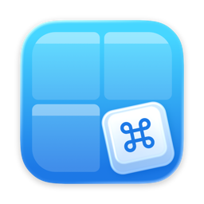

  

<h1 align="center">CMDKit Ultra</h1>

<b>Launch everything. Snap anything.</b> 
A menu bar app for your Mac that opens apps, folders and websites, and moves windows, with one keyboard shortcut.

<a href="https://github.com/shawnbierman/cmdkit-ultra/releases/latest"><b>Download the latest release</b></a> · <a href="https://cmdkit.app">cmdkit.app</a>

## What it does

- **Application shortcuts.** Press a keyboard shortcut and the app opens, or comes to the front.
- **Folder and website shortcuts.** Open a folder in Finder or a page in your browser the same way.
- **Window snapping.** Draw any region on a grid, like a left half, a middle third or a top corner, and send the front window there with a shortcut. Maximize, Center and Restore are built in.
- **Tidy spacing.** Leave a gap around snapped windows, on every display.
- **Stays out of the way.** Lives in the menu bar, with no Dock icon.
- In English, Spanish and French.

## Try it free for 14 days

Everything works during the trial. After it, buy a license at [cmdkit.app](https://cmdkit.app) and paste the key into Settings, License. Your key is checked on your Mac, with no account and no internet connection needed.

## Permissions, in plain words

Window snapping uses macOS Accessibility, which macOS describes as letting the app "control this computer". CMDKit Ultra uses it only to read the front window's position and size, and to move and resize that window. It never reads what's in your windows. Everything else works without it.

## Requirements

- macOS 14 Sonoma or later, on Apple silicon or Intel (a single Universal app).
- Updates arrive in the app through **Check for Updates…** in the menu.

## About this repository

This repository holds CMDKit Ultra's releases. Every build is signed with Developer ID and notarized by Apple. The source code is not public.

Prefer the Mac App Store? CMDKit is also on the App Store, without window snapping.

Questions or bugs: [open an issue](https://github.com/shawnbierman/cmdkit-ultra/issues).

Apple, Mac and macOS are trademarks of Apple Inc., registered in the U.S. and other countries.
